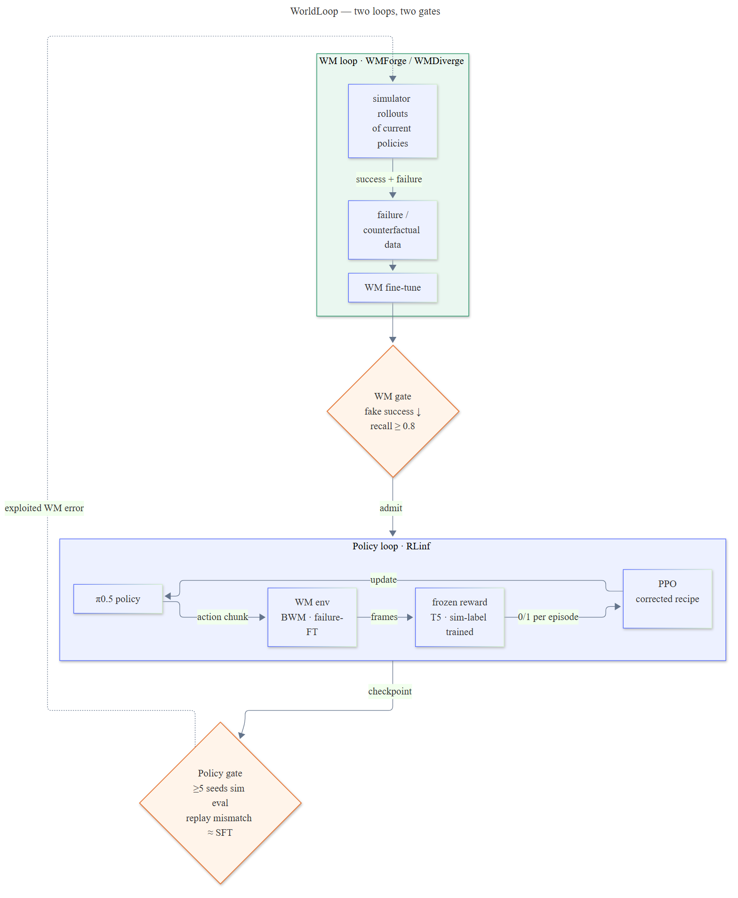
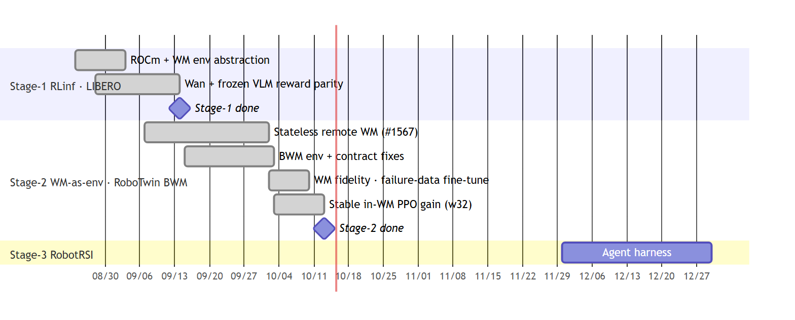

# WorldLoop

WorldLoop trains embodied policies (VLAs and similar) with online RL inside a world model (WM) used as the
environment. **Stage-2 result: on RoboTwin `adjust_bottle`, π0.5 trained with PPO inside a failure-fine-tuned
Boundless World Model beat its SFT start on held-out simulator evaluation in 5 / 5 training seeds (mean +9.7 pp).**
The full pipeline that produced it is reproducible from [`recipes/robotwin-bwm-ppo`](recipes/robotwin-bwm-ppo/README.md).

A WM is worth using where a simulator does not exist. Simulator coverage is capped by what people can model
(assets, contact, lighting, scenes); a WM learns from video, so its boundary follows the data, and the deployment
setting, the real world, has no simulator. A WM has no correctness guarantee, so the path is to measure on
benchmarks that still have a simulator how much a WM loses as a stand-in, then move to settings without one.
Where the simulator is cheap and physically correct, using a WM is a net loss; those benchmarks are the
calibration field, not the proof of value.

## Technical choices

A WM as environment has no physical state, no oracle, and costs compute per interaction. Four choices follow:

1. **On-policy PPO with the critic as a baseline only.** Without physical state the critic cannot separate
   samples (explained variance near 0), and dropping it does no better. The stable recipe turns off truncation
   bootstrapping, puts the critic on the VLM features with a warm-up, and lowers the value learning rate 10×.
2. **Reward is external, frozen, and trained on simulator outcomes.** A frozen T5 classifier trained on simulator
   success labels has a 0.07 false-success rate on simulator frames; zero-shot VLM judges are unreliable on WM
   output ([VLAW](https://arxiv.org/abs/2602.12063): 8 of 18 failures judged successful). When the WM draws a
   failure as a success, no reward that reads frames can correct it; that is fixed on the WM side with failure
   data. The classifier is retrained per task; what carries across benchmarks is the procedure, not the weights.
3. **Sample volume comes from cheaper generation** (diffusion steps, KIR, serving batching and weight
   sharing), not from replaying old samples, which multiplies WM dynamics bias by the reuse count. On RoboTwin
   the rollout phase takes about 97% of each training step.
4. **Acceptance is always the official evaluation in a real simulator or on a real robot.** Success inside the
   WM does not track the trend; it only flags collapse.

## Two loops, two gates

**The inner loop trains the policy inside the WM; the outer loop repairs the WM with simulator outcome labels.
A WM gate and a policy gate are judged separately.** When evaluation shows the policy exploiting a WM error,
those trajectories go back to the outer loop. Without a simulator, the outer loop's simulator is replaced by
real-robot rollouts; the structure stays the same.

> Source `images/worldloop-architecture.mmd`; regenerate with
> `npx @mermaid-js/mermaid-cli -i images/worldloop-architecture.mmd -o images/worldloop-architecture.png -b white -s 2`.

On RoboTwin the WM runs in process; remote serving through vLLM-Omni works for the stateless path and comes back
when rollout scale needs it.

## Stages

### Stage-1 (Aug 24 – Sep 14) — WM-as-env recipe in RLinf · LIBERO

1. `WorldModelEnv` / `WorldModelBackend` abstraction in RLinf — **done**
   ([#1518](https://github.com/RLinf/RLinf/pull/1518), merged).
2. Wan WM + reward model running LIBERO RL as the baseline — **done**; the pipeline runs, but the success
   metric does not rise with training steps (open).
3. Frozen VLM reward (TOPReward, Qwen3-VL) wired in — **done**. A step is dominated by WM generation plus
   scoring (63%) and actor training (30%); policy inference is 5%, so the frozen components, not the
   policy, are the ones worth moving to serving.

### Stage-2 (Sep 7 – Oct 13) — WM-as-env calibration on RoboTwin · BWM — done

**A WM is not usable as an RL environment just by plugging it in.** It took three things together: a BWM
fine-tuned with failure data, a frozen reward trained on simulator outcomes, and a corrected PPO recipe. The
WM still draws as successes some failures that are decided by fine action details from the same initial state;
at this training budget the policy did not exploit them.

1. **Remote WM serving (stateless)** — done; the RLinf side stays a draft
   ([#1567](https://github.com/RLinf/RLinf/pull/1567)). Co-located serving is not faster than local inference,
   and mp4 transport over HTTP costs 1.06 dB PSNR, so RoboTwin uses in-process inference. Generation speed is
   parked: it limits how large a run can be, not whether RL works.
2. **WM fidelity** — done for `adjust_bottle`. BWM `step-12000` was trained on planner successes only and drew
   82.5% of simulator failures as successes; fine-tuning with failure data brought that to 26%. Success-only data
   did not help, and adding updated-policy trajectories did not remove the rest.
3. **Stable in-WM RL gain** — done. The old PPO recipe collapsed in 1 of 5 seeds; with the three fixes above,
   5 / 5 seeds improved over SFT and the replay mismatch rate stayed at the SFT level.
4. **Hard cases** — failures decided by action details from the same initial state are a structural WM defect;
   counterfactual data (same actions up to the branch, perturbed only at contact) goes to WMDiverge.

The conclusion holds for `adjust_bottle` at this budget; it does not extend to other tasks, longer training or
settings without a simulator.

### Stage-3 (since Sep 30) — RobotRSI: failure recovery and skill evolution

The main line moved from WM fine-tuning to an improvement loop of agent plus execution policy; WM + RL stays as
the long-term research direction. First deliverable: a reproducible baseline / recovery comparison with a failure
taxonomy, against pre-registered success-rate and cost criteria. Tasks expand, or code → data → weights is
attempted, only after it passes; a negative result is still delivered as a located boundary.

## Components

| Project | Role | Status |
|---|---|---|
| RLinf | Embodied RL engine; WM env abstraction upstream | Stage-1 merged; RoboTwin trees pinned in `recipes/` |
| WMForge | Action-conditioned WM fine-tuning with success and failure trajectories | RoboTwin · BWM calibrated (Stage-2) |
| WMDiverge | Predicting action-driven success / failure branching in embodied WMs | Starting |
| vLLM-Omni | Rollout / serving / WM substrate | Stateless path works; returns when rollout scale needs it |
| verl-vla | VLA post-training architecture | — |
| verl-omni | Diffusion / generative RL engine | — |

## Repository

| Path | What |
|---|---|
| [`recipes/robotwin-bwm-ppo`](recipes/robotwin-bwm-ppo/README.md) | Stage-2 pipeline: data collection, T5 reward, WM fine-tuning, PPO with critic, simulator eval |
| `third_party/` | RLinf, RoboTwin, BWM as submodules at the commits the recipes patch |
| [`docs/roadmap.md`](docs/roadmap.md) | Timeline |

How to contribute: [CONTRIBUTING.md](CONTRIBUTING.md).
