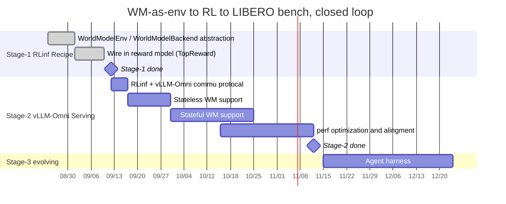

# TimeLine

## Stage-1（Aug ~ Oct）— WM-as-env RLInf recipe

* [pr-1518](https://github.com/RLinf/RLinf/pull/1518)
* [pr-1554](https://github.com/RLinf/RLinf/pull/1554)

## Stage-2（Oct ~ Nov）— vLLM-Omni Serving

## Stage-3(Nov ~ Dec) - Self-Evolving Loop 

